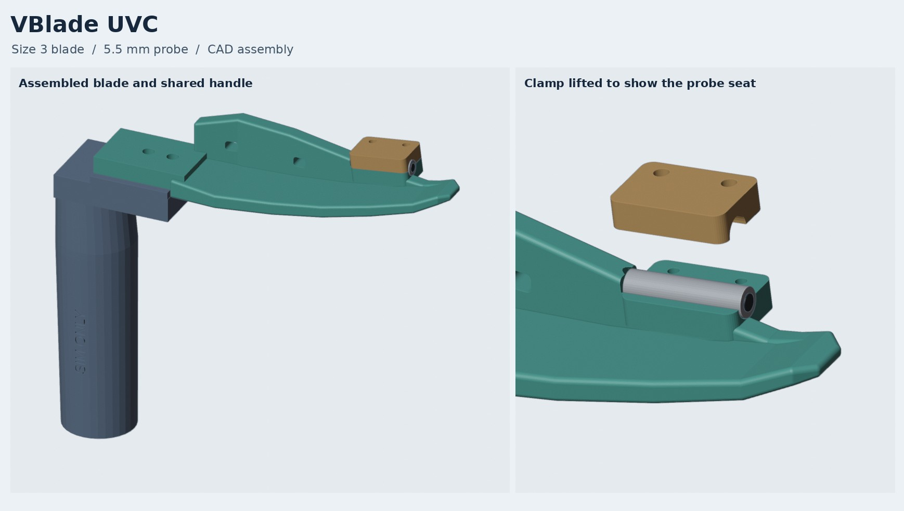
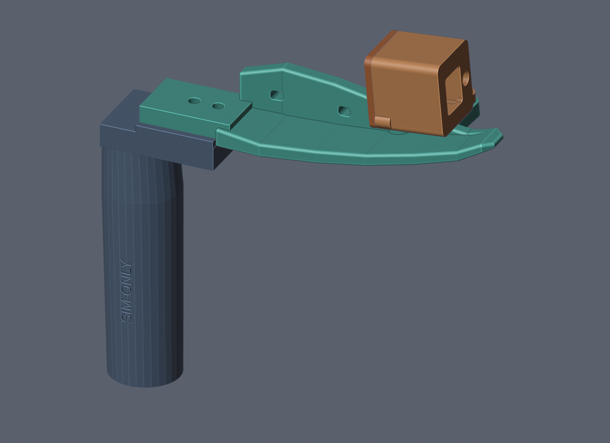

# VBlade

**Airway trainer only. Use on a dry manikin or a bench fixture.** The printed structure, electronics, optics, and firmware are unvalidated for patient contact or airway management. Use distinct filament colors and keep the prototype with simulation equipment.

VBlade uses a curved Macintosh-style blade with an open tube path, a rigid handle, and a forward-facing camera and white LED in a removable distal pod. One handle and one pod fit both blades. The bench display connects through a wired SPI harness.

**Version 0.1** · [Print files](stl/) · [Editable CAD](cad/vblade.scad) · [Firmware](firmware/VBlade/) · [Support VBlade on Buy Me a Coffee](https://buymeacoffee.com/ahmedtariqh)

## Slim USB camera variant



[VBlade UVC](docs/uvc-build.md) uses a 5.5 mm or 7.0 mm illuminated USB borescope and a bench-mounted ESP32-S3/ST7789 monitor. The build guide includes both blade sizes, the printable probe clamp, wiring, firmware and the upstream projects that informed the design.

## Original XIAO camera build

The sections below cover the original V0.1 camera pod and XIAO display firmware.



### Quick start

1. Print the handle, both blades, the pod, the cover and the display stand.
2. Build and flash the firmware to a XIAO ESP32-S3 Sense with OPI PSRAM enabled.
3. Wire and test the TFT and camera on short leads, then install the camera and LED in the pod.
4. Verify fit, image orientation and video-loss behavior before using a dry airway trainer.

The LCD is on a separate bench stand. The first design keeps the XIAO board in the pod to use the stock camera flex, so the camera housing is the bulkiest part near the blade's tip. Use the assembly preview to check its position relative to the tube path.

## What to print

| STL | Use | Print setup |
| --- | --- | --- |
| `blade_3.stl` | 104 mm nominal reach from the handle interface plane | As exported. Support under the curved sole, bolt pads, and other overhangs. |
| `blade_4.stl` | 124 mm nominal reach from the same plane | Same as size 3. |
| `handle.stl` | Shared grip and keyed saddle | Rotate on its side where practical and use supports. Keep supports clear of fastener holes where possible. |
| `pod.stl` | Shared distal camera and lamp housing | Front face down as exported. Support the external mounting ears from the bed. Keep the cavity free of support where possible. |
| `pod_cover.stl` | Rear plate with cable opening and tie slots | Flat as exported. |
| `display_stand.stl` | Open tabletop support for the TFT | Flat as exported. |

The editable source is `cad/vblade.scad`. Select a part in the OpenSCAD Customizer, render it and export an STL. From a shell, for example, use `openscad -D 'part="blade_3"' -o blade_3.stl cad/vblade.scad`.

Import in **millimetres at 100%**. As a starting FDM setup, use PETG, a 0.4 mm nozzle, 0.2 mm layers, 5 perimeters and 35–45% infill on structural parts. Preview layer paths around the blade root, pod pads and screw holes. Deburr the parts and clear the holes by hand. These settings are for fit prototypes and confer no tested load capacity.

The 104 mm and 124 mm projected reaches take their nominal values from the published C-MAC HD adult size 3 and 4 working lengths. The CAD uses an original curved profile and a custom bolt interface. It has no commercial blade or handle interchangeability. The camera aperture is about 20 mm behind the nose and over the flange. The complete camera/processor stack stays in the pod, keeping the stock sensor flex in use. This increases distal bulk, so check the direct view and tube path on the intended trainer.

## Parts

| Qty | Item |
| --- | --- |
| 1 | Seeed Studio XIAO ESP32-S3 **Sense**, SKU 113991115, with its camera adapter and stock camera. The pod layout targets the OV3660 revision and expects direct solder leads on the XIAO pads. |
| 1 | 240×320 ST7789 SPI TFT with CS, DC and reset. Reference breakout is Adafruit #4311 (2.0 in, 59.2 × 35.5 mm board). |
| 1 | Wide-angle, diffused 5 mm white LED, 220 Ω ¼ W resistor, and heat-shrink. |
| 1 | 5 V USB power bank rated 1 A or more, USB 5 V breakout/pigtail, SS14 or equivalent Schottky power diode, and an optional inline switch. |
| 2 each | M4×25 bolts, flat washers for both faces and M4 locking nuts for the handle. |
| 2 each | M3×16 bolts, flat washers for both faces and M3 locking nuts for the pod. |
| 2 | M2.5×6 plastic-thread-forming screws for the pod cover. Verify the 2.1 mm printed pilot gives a snug fit. |
| As needed | Flexible insulated harness wires, small ties, nonconductive foam or TPU shims, insulated hook-and-loop strips, and a polarized inline connector. |

The reference controller and TFT list for $13.99 and $19.95 at their respective vendors. A generic **3.3 V logic, 4-wire SPI, 240×320 ST7789** breakout may be cheaper. Match the actual power and backlight requirements, verify that pins for CS, DC and reset are exposed, and run the color-bar test. A generic board with a panel offset, different initialization sequence, or no CS can need a firmware change. The open stand uses adjustable adhesive strips. Egyptian listings are linked below for comparison.

## Wiring

The XIAO drives the screen and takes video from its stock camera socket. Run the TFT harness outside the blade, along the flange and handle, and toward the stand. First bring up the display on short leads, then test the assembled cable. Keep clock next to a ground return and use a separate ground return next to MOSI if available. Start with the shortest practical cable. If the screen shows intermittent corruption, lower `TFT_SPI_HZ` to 8 MHz and repeat the motion test on the full harness.

| From | To |
| --- | --- |
| XIAO D8 / GPIO7 | TFT SCK (some TFTs mark this SCL) |
| XIAO D10 / GPIO9 | TFT MOSI (some TFTs mark this SDA) |
| XIAO D3 / GPIO4 | TFT CS |
| XIAO D4 / GPIO5 | TFT D/C |
| XIAO D5 / GPIO6 | TFT RST |
| 5 V source through series Schottky diode | XIAO 5V pad. Anode toward source, striped cathode toward the XIAO. |
| 5 V source directly | **Adafruit #4311** VIN. For generic breakouts, use the module's documented supply voltage. |
| 5 V source → 220 Ω resistor → white LED anode | LED cathode to common GND. Use heat-shrink and keep the leads separated. |
| Common 0 V | XIAO GND, screen GND and LED cathode |

Leave the SD slots empty. The XIAO Sense SD board shares the SPI lines. On the reference TFT, leave BL open for its onboard default, and leave MISO, SDCS and 3Vo unused. The LED runs from the switched supply and is independent of the firmware. At a 3.0 V LED forward voltage, the 220 Ω resistor gives about 9 mA. Flash the controller over its own USB-C with the external power and TFT harness disconnected. For standalone use, unplug USB-C and power through the external harness.

## Assembly

1. Inspect the printed blade and handle. Place the blade tongue between the saddle rails and seat it flat. Insert both M4 fasteners and washers, install the locking nuts, and check for visible rocking or cracks. Snug the fasteners by hand without crushing the print.
2. Bench-test the camera, TFT, and LED before putting them in the housing. With power disconnected, feed the harness through the rear cover. Insert the camera stack from the rear, lens facing the rectangular front opening. The cavity is nominally **24 × 22.4 × 24 mm** before corner bosses. Shim the stack with nonconductive compressible pads to bring the lens near the opening without forcing the stock flex. Keep the small sensor board and lens supported by their housing, with clearance around the flex.
3. Seat the LED behind its circular opening. Fit a small matte-black nonconductive baffle around the light if glare enters the lens. Secure the LED and the stack before powering the pod. Use the two cover screws, then tie the insulated harness to the cover so movement does not pull on the solder pads.
4. Seat the pod tabs on the blade's two matching pads. Fit the two M3 fasteners with locking nuts. Route the harness through cable ties at the blade web slots and around the handle. Leave a small service loop and keep the tube side clear. To swap sizes, power off and transfer the whole pod, including its LED and controller, along with the shared handle.
5. Put the TFT on the stand with insulated hook-and-loop strips on the back of the board. Keep its PCB and exposed connections away from conductive surfaces. Confirm the lens has an unobstructed view and the pod and LED remain retained when the harness moves.

## Build and upload

The sketch targets **Arduino-ESP32 3.3.5**, board **XIAO_ESP32S3**, **OPI PSRAM** enabled, and default USB CDC on boot. It uses Adafruit GFX 1.12.4, Adafruit ST7735 and ST7789 1.11.0, and Adafruit BusIO 1.17.4. Open `firmware/VBlade/VBlade.ino` in Arduino IDE, or run these commands from the extracted folder.

```bash
arduino-cli core install esp32:esp32@3.3.5 \
  --additional-urls https://espressif.github.io/arduino-esp32/package_esp32_index.json
arduino-cli lib install "Adafruit BusIO@1.17.4" \
  "Adafruit GFX Library@1.12.4" "Adafruit ST7735 and ST7789 Library@1.11.0"

board=esp32:esp32:XIAO_ESP32S3:PSRAM=opi
arduino-cli compile --fqbn "$board" --output-dir build firmware/VBlade
arduino-cli board list
arduino-cli upload --fqbn "$board" --input-dir build --port /dev/ttyACM0 firmware/VBlade
```

Replace `/dev/ttyACM0` with your actual USB serial port. Arduino CLI also creates `build/VBlade.ino.merged.bin` for the reference board. If you use esptool 5.x, you can flash that merged image at address zero on the named board. Writing the merged image overwrites existing flash contents.

```bash
python -m esptool --chip esp32s3 --port /dev/ttyACM0 \
  write-flash 0x0 build/VBlade.ino.merged.bin
```

If the board is absent from the port list, use the Seeed boot procedure: hold BOOT, press and release RESET, then release BOOT. Check the port again.

## Bench checks

1. **Display.** Set `DISPLAY_TEST_PATTERN = true` in `Settings.h`, compile/upload, and look for red, green, blue, white and black vertical stripes. Check full width and text orientation. Then restore `false` and reflash. Panel rotation defaults to landscape; use rotation 3 if the display is mounted upside down.
2. **Live image.** Use a colored, asymmetric target at 25, 40 and 60 mm from the lens. Confirm focus, framing, light uniformity, and that left/right and up/down match the physical motion. Adjust `CAMERA_HMIRROR` / `CAMERA_VFLIP` in pairs or individually as needed for the mounting orientation. If the LCD test is correct but camera colors are corrupted, check `CAMERA_MS_BYTE_FIRST` with the colored target.
3. **Video loss.** Try startup with the camera disconnected by powering down before removing the sensor flex. The screen should show `NO VIDEO` after the startup state. Restore the camera with power off and confirm recovery on restart. For a live-stall simulation, have a debug build pause the camera task after it has returned a frame, while leaving `loop()` alone. Confirm the previous image disappears, and that it reappears only after a new frame. Firmware checks for a frame older than 400 ms. Blanking itself takes additional SPI time and cannot diagnose a failed display bus or a stalled display task. A repeated image with fresh transport timestamps can pass the check.
4. **Harness and duration.** Run on the final power bank for at least 30 minutes with the light on. Move the harness and log display glitches, resets, temperature rise near the camera and LED, and any power-bank auto-off. If measuring latency, film a moving timestamp and the screen in the same high-frame-rate recording. The 12 MHz SPI wire time alone for the video region is about 97 ms per frame; capture and rendering add overhead.
5. **Mechanics.** Use a dry trainer. Compare the two sizes for blade reach, access, direct view, camera view and clearance for a trainer tube. Confirm the fasteners stay tight and the retained camera, light, and harness do not shift. Stop the trainer run if any part loosens, cracks, or distorts. Record results separately for both sizes.

## Verification status

All six STL meshes passed digital checks for a watertight, consistently oriented, single solid. Both assembly sizes were checked for interference and M4/M3 fastener alignment. Both the live-video and LCD-test configurations compiled for the named ESP32-S3 target. The generated live image passed an ESP32-S3 image checksum check, and the Arduino-generated bootloader, partition table and app were verified at their expected offsets in the merged binary.

Physical print quality, fit, ergonomics, image quality, heat, and electrical performance remain to be measured. ISO 7376-2:2025 defines requirements for electrically powered video laryngoscopes. This package makes no conformity claim.

## Contributing

For a fit or print issue, include the blade size, filament, print orientation, slicer settings, and the affected part. For a display or camera issue, include the board and sensor revision, TFT model, SPI settings, and the result of the color-bar test. For a design change, update the OpenSCAD source and regenerate the affected STL files. Label measurements as bench or manikin results and use de-identified test material.

## License and support

The CAD source and STL meshes use [CERN-OHL-P-2.0](LICENSES/CERN-OHL-P-2.0.txt). The original firmware, documentation and CAD render use the [MIT License](LICENSES/MIT.txt). Dependency code remains under its upstream licenses.

If the project helps you, you can [support Ahmed on Buy Me a Coffee](https://buymeacoffee.com/ahmedtariqh).

## Design references

- [KARL STORZ MAC #3 dimensions](https://www.karlstorz.com/us/en/product-detail-page.htm?productID=1000111725) and [MAC #4 dimensions](https://www.karlstorz.com/us/en/product-detail-page.htm?cat=1000071971&productID=1000111733)
- [Seeed reference board](https://www.seeedstudio.com/XIAO-ESP32S3-Sense-p-5639.html), [pin mapping](https://wiki.seeedstudio.com/xiao_esp32s3_pin_multiplexing/), [power inputs](https://wiki.seeedstudio.com/xiao_esp32s3_getting_started/), and [OV3660 drawing](https://files.seeedstudio.com/wiki/SeeedStudio-XIAO-ESP32S3/new-res/OV3660_Camera_Module_Specification.pdf)
- [Espressif camera component](https://github.com/espressif/esp32-camera)
- [Adafruit #4311](https://www.adafruit.com/product/4311) and [reference display pinout](https://learn.adafruit.com/2-0-inch-320-x-240-color-ips-tft-display/pinouts)
- [Egyptian listing for a generic 2.4-inch ST7789 SPI module](https://electronicsegypt.com/ar/p/2-4-inch-tft-spi-display-240x320-with-st7789-driver)
- [ISO 7376-2:2025](https://committee.iso.org/standard/85508.html)
