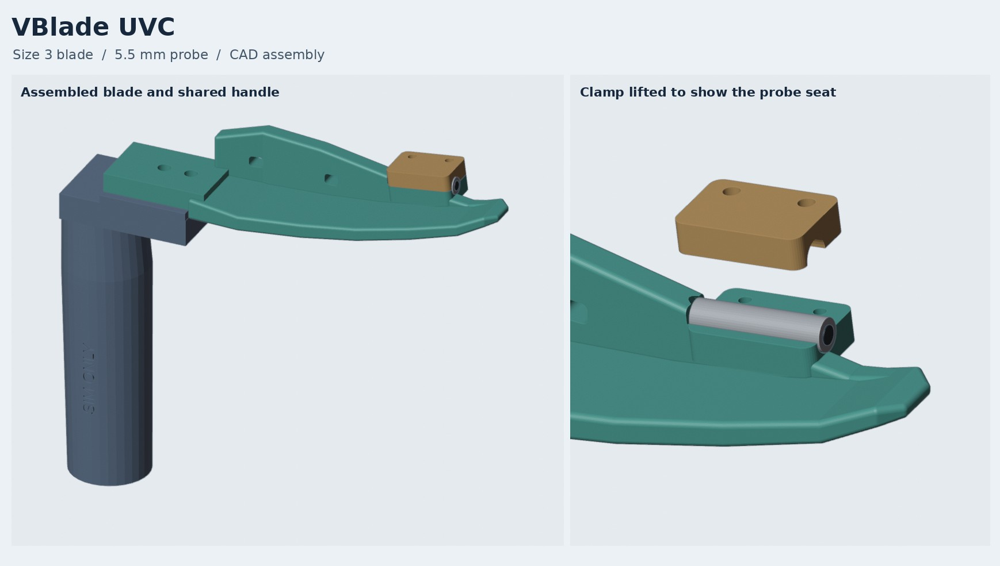

# VBlade UVC

**Bench and airway-manikin use only.** No hardware has been tested on this revision. Keep the assembly with simulation equipment.

VBlade UVC uses a cylindrical USB Video Class (UVC) borescope with built-in LEDs. The camera plugs into a host and display stationed on the bench. The blade has a shaped camera seat on its lateral flange and a screw-on clamp. The electronics stay off the blade. The VBlade handle fits both adult sizes.



## Choose the parts

| Item | Specification |
| --- | --- |
| Camera | Straight, forward-facing 5.5 mm or 7.0 mm cylindrical UVC borescope head with built-in LEDs and at least 22 mm of straight body for retention. Measure the body and cable exit before printing. Use a model that enumerates at USB full speed and advertises MJPEG at the selected resolution and frame interval. |
| Display controller | Espressif ESP32-S3-DevKitC-1 N8R8 with 8 MB OPI PSRAM. The MCU does USB host and JPEG decoding on the bench. |
| LCD | 240 × 320 ST7789 SPI breakout with MOSI, SCK, CS, DC and RESET. Adafruit #4311 is the reference pinout. Existing VBlade LCD and stand can be reused. |
| USB and power | USB-A female breakout matched to the camera connector, short twisted D+/D− pair, and a regulated 5 V supply with current limit and sufficient headroom for the camera LEDs. |
| Handle attachment | Two M4×25 bolts, four washers and two locking nuts. |
| Probe clamp | Two M2.5×10 thread-forming screws for plastic. Measure pilot diameter and usable length on the print. The cap has 5.4 mm nominal thickness at the holes and the pilot depth is 4.8 mm. |
| Strain relief | Small cable ties and thin nonconductive shim material to take up probe diameter tolerance. |

The firmware requests 640 × 480 MJPEG at 15 fps and decodes at half resolution for the LCD. 320 × 240 MJPEG is selectable in the firmware. Camera listings and vendor names are insufficient to establish compatibility. If the camera exposes MJPEG only at high speed, or sends YUY2 only, it may work on a computer and fail on this ESP32-S3 host. Check the exact model at full speed before buying multiple units. On Linux use `v4l2-ctl -d /dev/video0 --list-formats-ext` and `lsusb -t` as starting checks. An Android UVC viewer or desktop USB camera viewer can also be used independently to test the optics.

## Print and assemble

| Reach from handle plane | Camera body | Blade STL | Clamp STL |
| --- | --- | --- | --- |
| 104 mm | 5.5 mm | [Size 3](../stl/uvc/blade_3_5_5mm.stl) | [5.5 mm](../stl/uvc/clamp_5_5mm.stl) |
| 104 mm | 7.0 mm | [Size 3](../stl/uvc/blade_3_7_0mm.stl) | [7.0 mm](../stl/uvc/clamp_7_0mm.stl) |
| 124 mm | 5.5 mm | [Size 4](../stl/uvc/blade_4_5_5mm.stl) | [5.5 mm](../stl/uvc/clamp_5_5mm.stl) |
| 124 mm | 7.0 mm | [Size 4](../stl/uvc/blade_4_7_0mm.stl) | [7.0 mm](../stl/uvc/clamp_7_0mm.stl) |

Use the shared [handle](../stl/handle.stl) and [display stand](../stl/display_stand.stl). Import in millimetres at 100% scale. Orient blades as exported, with support under the sole, flange and clamp bed as needed. The cap is exported with its flat exterior face down and the bore facing up. Inspect the first print for residual supports and cracks near holes. The [original print guide](../README.md#what-to-print) has starting settings. Regenerate the six UVC STLs with `bash cad/export_uvc.sh`.

1. Seat the blade in the handle and fit the two M4 fasteners and locking nuts.
2. Place the camera head in the open cradle with its face at the forward edge of the clamp and the cable pointing toward the handle. Make sure no plastic masks the lens or LED ring. The modeled camera face is about 21 mm back from the blade nose.
3. Use the matching cap and two screws. Take up loose clearance with a thin shim along the bore so the cap seats flat and the probe cannot slide or rotate. Tighten evenly by hand and confirm the screws engage the printed pilots without splitting them.
4. Tie the probe cable to the blade web slots, with a loose loop at the probe. Confirm the cable cannot pull the head forward, enter the tube path, or rotate the image when the main lead is tugged.
5. When changing blade size, power off the monitor and transfer the probe, clamp and handle to the other blade of the same bore diameter.

## Wire the bench monitor

| Signal | ESP32-S3-DevKitC-1 connection |
| --- | --- |
| TFT SCK | GPIO12 |
| TFT MOSI | GPIO11 |
| TFT CS | GPIO10 |
| TFT D/C | GPIO9 |
| TFT RESET | GPIO8 |
| TFT VIN | 5 V for Adafruit #4311. Check a different panel's specification. |
| USB D− / D+ | GPIO19 / GPIO20 respectively |
| USB VBUS | The regulated 5 V rail, never a GPIO or 3.3 V pin |
| GND | Common to board, LCD, USB and supply |

Keep the D+/D− connection short and paired. Use a single source for the finished bench system. Leave the DevKit's native USB socket empty when its D+/D− pins are wired to the external host breakout. Flash through the DevKit's separate USB-to-UART connector with external 5 V and the camera disconnected. On the reference TFT leave MISO, SDCS, BL and 3Vo unconnected.

## Build and flash

The UVC driver version uses an ESP-IDF host-controller interface present in Arduino-ESP32 **3.2.1**. Pin that core separately when building UVC. The original VBlade sketch has its own core version. The 3.3.5 core failed to link against this USB driver during development.

```bash
arduino-cli core install esp32:esp32@3.2.1 \
  --additional-urls https://espressif.github.io/arduino-esp32/package_esp32_index.json
arduino-cli lib install 'ESP32_USB_STREAM@0.1.0' 'JPEGDEC@1.8.5' \
  'Adafruit BusIO@1.17.4' 'Adafruit GFX Library@1.12.4' \
  'Adafruit ST7735 and ST7789 Library@1.11.0'

board=esp32:esp32:esp32s3:PSRAM=opi,FlashSize=8M
arduino-cli compile --fqbn "$board" --output-dir build firmware/VBladeUVC
arduino-cli board list
arduino-cli upload --fqbn "$board" --input-dir build --port /dev/ttyUSB0 firmware/VBladeUVC
```

Replace the serial port with the DevKit's USB-to-UART port. In [Settings.h](../firmware/VBladeUVC/Settings.h), set `CAMERA_WIDTH`, `CAMERA_HEIGHT` and `CAMERA_FPS` to a supported MJPEG mode, and set `ROTATE_CAMERA_180` if required. The receive callback only takes the newest complete matching frame. Decoding happens in the display task. A USB disconnect or lack of a recent frame triggers a black `NO VIDEO` screen. The 400 ms freshness check uses host receipt time. Decoding and LCD write time are additional, and a frozen camera that continues to send frames can pass it.

## Verification

The default UVC sketch compiled for the ESP32-S3 with the pinned toolchain. All six UVC STL files passed digital single-solid, watertight and orientation checks. Digital checks for all four blade/probe combinations covered clamp interference, cylindrical probe clearance, clamp screw clearance and the shared handle interface. The modeled size 3 blade envelope is about 34.6 mm wide before the cable and screws, compared with 47.5 mm for the original size 3 blade with its pod seat. The seat and clamp together form a 14.7 mm wide by 10.8 mm high local body around the camera axis. Host tests of the firmware decoder checked pixel values and image position for native and half-size JPEG, 180-degree rotation, and rejection of a broken JPEG header.

Begin physical testing on the bench. Check enumeration, image orientation with an asymmetric target, usable focus distance and the LED ring. Unplug and reconnect the camera while viewing the display and confirm loss and recovery. Mark the probe and seat with witness marks and check for axial motion or rotation when routing the cable. Compare access, view and tube clearance on a dry trainer. Capture actual frame rate, glass-to-glass latency and temperature before making performance claims.

## Upstream projects and reuse

| Project | What VBlade UVC uses |
| --- | --- |
| [AirAngel](https://www.airangelblade.org/download) and its [manikin comparison](https://pmc.ncbi.nlm.nih.gov/articles/PMC11351083/) | Small-diameter flexible-camera architecture and 5.5/7 mm compatibility targets. AirAngel distributes its blade files under CC BY-NC and lists personal-use terms. VBlade UVC uses the VBlade blade source and an independently modeled cradle. |
| [GHAVL preprint by Matthew and Raymond Gue](https://doi.org/10.21203/rs.3.rs-8504721/v1) | Evidence that a low-cost borescope and a separate retaining geometry are an established approach. Its reported load and deflection figures are simulations of that design. |
| [VL3D study](https://www.scielo.br/j/bja/a/k5zmF9RgDC5kNFZxcDxZjNr/?lang=en) and [Dr. MRod build](https://drmrod.com/wp/2021/09/17/7-3d-printed-video-laryngoscope/) | Comparators for a small camera and display. The VL3D article identifies its design as CC BY-NC-ND. The Dr. MRod article links an STL but a redistributable CAD license could not be verified. |
| [Espressif USB camera LCD project](https://github.com/espressif/esp-box/tree/master/examples/usb_camera_lcd_display), [ESP32_USB_STREAM](https://github.com/esp-arduino-libs/ESP32_USB_Stream) and [JPEGDEC](https://github.com/bitbank2/JPEGDEC) | The local-display architecture and actual upstream dependencies for USB MJPEG host capture and RGB565 decoding. Both dependencies use Apache-2.0 and are installed from Arduino Library Manager. VBlade's new sketch provides the ST7789 output and video-loss handling. |

VBlade's native CAD and STLs retain CERN-OHL-P-2.0. Its original firmware remains MIT-licensed. See the [repository license](../LICENSE).
